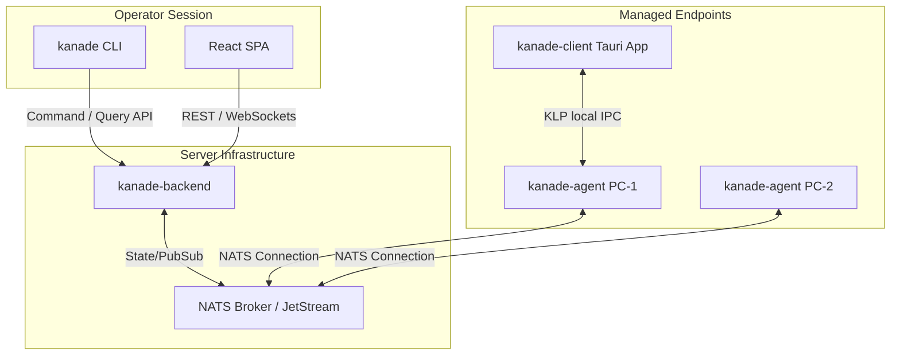

# System Architecture

`kanade` is designed to manage Windows, Linux and Apple Silicon macOS endpoints asynchronously.
Available inventory, session and desktop features differ by platform.

## Component Topology

The system consists of five main components, coordinated through an event-driven pub/sub structure:

### 1. kanade-agent
A resident executor: Windows service, Linux systemd service or macOS launchd daemon.
- **Role**: Core executor.
- **Communication**: Establishes an outbound-only NATS connection. It does not open any inbound ports, making it firewall-friendly.
- **Capabilities**: Executes jobs, reports inventory and performance data, and performs self-update. Shells include Windows PowerShell, PowerShell 7 (`pwsh`) and `sh`; install the selected host on the target. Windows-specific sensors and jobs do not become portable automatically.

### 2. kanade-backend
The central HTTP API and projection server.
- **Role**: Coordinates commands, processes incoming telemetry, and hosts the operator Web interface.
- **State management**: Persists events, activity logs, and status records in a localized SQLite database.
- **Projector pattern**: Subscribes to the NATS command-response stream, parses incoming payloads, and projects them into state tables in real-time.

### 3. NATS Broker (with JetStream)
The message transport layer of the entire fleet.
- **Role**: Lightweight, high-throughput message broker.
- **JetStream**: Retains command streams, job registrations, and file storage (using NATS Object Store buckets for distributing packages and agent scripts).
- **Isolation**: Decouples the backend from the agents. If the backend is offline or restarting, agents continue execution and cache outbox records, pushing them once connection resumes.

### 4. kanade-client
An optional Tauri desktop application running in the logged-in user's desktop session on endpoints.
- **Role**: Provides end-user interaction (e.g., prompt dialogs, notifications, or a user-facing dashboard).
- **Communication**: Shares state with the local `kanade-agent` via secured local IPC mechanisms.

### 5. kanade CLI
The primary command-line tool for operators.
- **Role**: Packages and publishes software updates, submits and executes job manifests, and queries live fleet inventory from the command-line.

---

## Security & Reliability Design

### Outbound-only Connections
Agents initiate outbound NATS connections (including WebSocket deployments). Package installation jobs may also download artifacts through the backend HTTP API. No inbound network listener is needed on managed endpoints; local KLP IPC is separate. Broker authentication, permissions and command-signing policy still determine who can issue commands.

### Agent Job Identity
PowerShell scripts use private per-execution staging directories, under
`%ProgramData%\Kanade\agent-scripts` on Windows, or the platform-specific
macOS staging root / Unix temporary directory. Job manifests select
`run_as: system`, `user` or `system_gui`; identity support differs by OS.
These are process identity and staging protections, not a sandbox for untrusted
scripts: production system jobs run as LocalSystem / root. See the
[macOS identity rules](https://github.com/kanadehq/kanade/blob/main/deploy/macos/README.md#job-identity-run_as).
